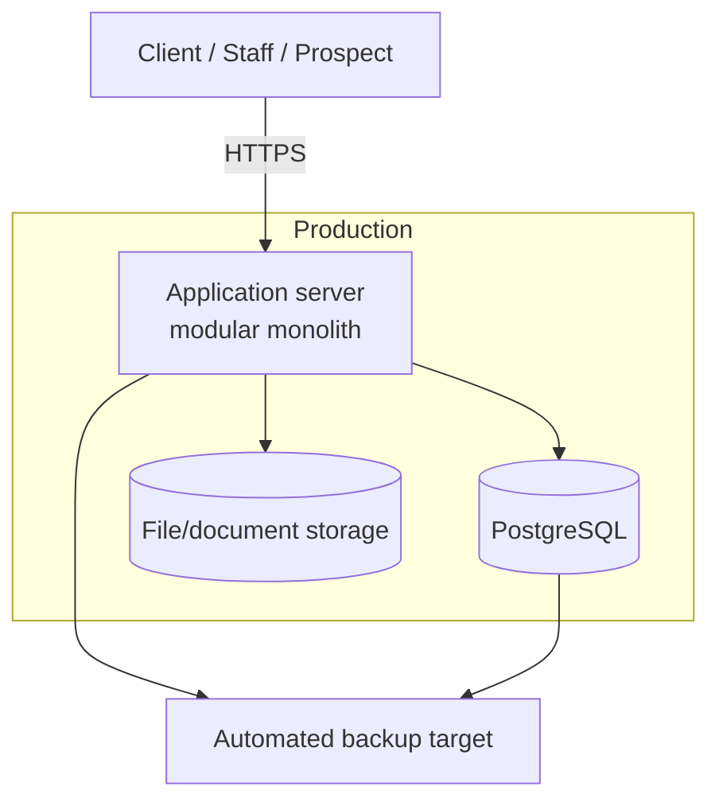

# Z-GATE Digital Platform — Deployment Architecture

## Cost baseline (governs every choice below)

The 90-Day Financial Model allocates RWF 1,000,000 across "Tools & software (accounting, EBM-compliant systems, LMS, hosting)" **collectively** for the entire first 90 days (`docs/business/BUSINESS_RULES.md` §8) — hosting is a share of that, not a dedicated line. This architecture is built to run on a genuinely small budget, not scaled-down enterprise defaults. Every infrastructure choice below should be read against that constraint.

## Environments

| Environment | Purpose | Data rule |
|---|---|---|
| **Development** | Local/individual developer work | Synthetic/seed data only — **never real Client production data**, per the already-committed rule (Data Privacy Policy Annex C, restated in `DATA_ARCHITECTURE.md`) |
| **Staging** | Pre-production verification | Same rule — anonymized or synthetic data only, unless a specific Client has given written consent (which is not expected to happen at this scale) |
| **Production** | Real system | Real data, full backup/monitoring/access-control scope |

Two real environments (staging + production) plus local development is the minimum that satisfies the already-committed separation rule — not three or four environments, which this team's size (one contract/intern developer at MVP) couldn't realistically maintain anyway.

## Infrastructure topology

**Vertical-first, single small server/managed-platform instance** for the application, plus a managed (or self-hosted, pending ADR-004) PostgreSQL instance:

- **No container orchestration platform (Kubernetes, ECS, etc.)** at MVP/V1/V2 — a single deployable monolith on a single well-sized instance (or a basic managed PaaS) is correct at this scale and dramatically cheaper to operate and reason about than an orchestration layer with no real multi-service or multi-instance need yet.
- **No CDN required at MVP** beyond whatever a basic hosting platform provides by default — traffic volume doesn't justify dedicated CDN spend yet; revisit if/when the public website's real traffic (post Day-90 reach targets) demonstrates a need.
- **Scaling posture:** vertical scaling (a larger instance) is the answer for as long as it remains cheaper and simpler than horizontal scaling, which is true well past this platform's realistic 12-month trajectory (`docs/business/BUSINESS_RULES.md` §8's 12-month outlook still describes a modest-scale operation). Horizontal scaling / the module-extraction points noted in `MODULE_ARCHITECTURE.md` are the documented path if that ever changes — not built now.

## Deployment region — the one open, unresolved question in this entire architecture

**This document does not pick a hosting region or vendor.** See ADR-004. The honest tension: the Data Privacy Policy commits to Rwanda-default data residency (`docs/business/BUSINESS_RULES.md` §4), but no major hyperscaler is confirmed in any approved document to have a Rwanda-based region, and NCSA registration (which governs any offshore-transfer certificate) is itself still "Pending" (`docs/discovery/SECURITY_BASELINE.md`). Picking a specific cloud region here would mean either fabricating the existence of infrastructure not confirmed to exist, or silently accepting a compliance gap — neither is this document's call to make. ADR-004 lays out the real options for the Managing Director and legal counsel to decide.

## CI/CD

- A simple, single pipeline: run tests → build → deploy to staging → (manual or automatic promotion) → deploy to production. No multi-stage approval workflow, no blue/green or canary deployment infrastructure — none of this is justified by current team size (one contract/intern developer) or traffic.
- Every deployment to production is preceded by a staging deployment — the one non-negotiable step, since it's what actually enforces the dev/staging/production separation the Data Privacy Policy already commits to, not just a nice-to-have practice.

## Backup & recovery

Operationalizes an already-committed rule: "Backups are taken on a schedule appropriate to each system's criticality and tested periodically for restorability" (Data Privacy Policy §7, `docs/business/BUSINESS_RULES.md` §4).

| System | Backup schedule | Retention | Restore testing |
|---|---|---|---|
| PostgreSQL (production) | Automated daily full backup + continuous/point-in-time recovery if the hosting choice supports it cheaply | 30 days rolling, minimum | Quarterly test restore to a non-production environment — not just "backups exist," but "backups actually restore," which is the distinction that matters for a compliance-critical filing record |
| File/document storage | Daily | 30 days rolling | Same quarterly cadence |

**Why this matters more than usual for this platform specifically:** the Advisory module's compliance_items and deliverables tables (`DATA_ARCHITECTURE.md`) are the digital record of statutory filings — losing this data isn't just a technical incident, it's a real compliance-evidence loss for a client's tax history. Backup discipline here is not boilerplate.

## Monitoring & logging (lightweight, matching the "observable" and "cost-conscious" requirements together)

- **Application logging:** structured logs (request/response summaries, errors) — enough to debug an issue, not a full distributed-tracing setup this single-service monolith doesn't need.
- **Uptime/error monitoring:** a basic external uptime check + error-tracking tool (specific vendor deferred) — proportionate to a small user base where "we found out from a client that it's down" would be a real embarrassment, but a full enterprise observability stack (metrics, dashboards, alerting pipelines) is not justified yet.
- **Audit logging** (`DATA_ARCHITECTURE.md`'s `access_log`) is a distinct, compliance-driven concern from operational logging above — it's about who-accessed-what for the Data Privacy Policy's access-review commitment, not about debugging application errors.

## What this document does not do

It does not name a specific cloud provider, hosting plan, or CI/CD tool — those are implementation decisions to be made once ADR-004's region question is resolved. It does not commit to a specific backup-tooling vendor. It does not design for a multi-region or high-availability topology this platform's real, current scale does not need.
