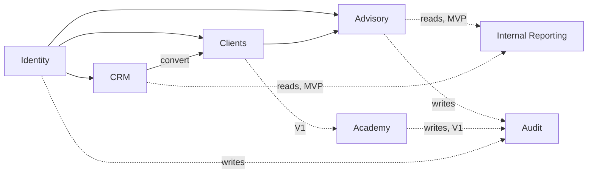

# Z-GATE Digital Platform — Domain Architecture

Detailed evaluation of the 16 domains this phase is required to assess, each verdict grounded in `docs/business/DOMAIN_MODEL.md`, `docs/product/PRODUCT_BACKLOG.md`, and the other approved phases — not in generic enterprise-software assumptions about what a company "should" have.

## Evaluation method

For each domain: **Is it real?** (does an approved business document actually describe this as something Z-GATE does or needs) → **When?** (MVP/V1/V2/Future, per the product roadmap) → **Boundary** (what it owns, what it explicitly does not own).

---

## 1. Identity — MVP

- **Real:** yes — staff and client logins are a hard MVP dependency (`docs/product/PRODUCT_BACKLOG.md` EPIC-04).
- **Owns:** user accounts (staff + client), credentials, sessions, role assignment.
- **Does not own:** authorization *decisions* (which role can see which resource) — that's enforced by each domain module against Identity's role data, not centralized in Identity itself (avoids a single module knowing every other module's access rules, which would violate module boundaries).

## 2. Clients — MVP

- **Real:** yes — the Client entity is the central relationship record (`docs/business/DOMAIN_MODEL.md` §2).
- **Owns:** Client record (legal name, TIN, address, primary contact), the link between a Client and its Engagements.
- **Does not own:** engagement-specific data (compliance status, deliverables) — those belong to the division module (Advisory, Academy, etc.) that owns the engagement.
- **Open question carried forward, not resolved here:** whether a Client record is shared across divisions or siloed per division is still open (`docs/business/OPEN_BUSINESS_QUESTIONS.md` #4). **Architectural default until answered:** one Client record, referenced by any number of division-specific Engagements — this is the cheaper, more consistent design to build toward, and is trivially compatible with a "siloed" interpretation later (division modules simply choose not to look at each other's Engagements) but not the reverse. Flagged as ADR-002.

## 3. CRM — MVP, minimal

- **Real:** yes — lead tracking (`docs/product/PRODUCT_BACKLOG.md` EPIC-02/03).
- **Owns:** Lead record (channel, stated need, status), conversion-to-Client action.
- **Does not own:** anything beyond what FEAT-03.1/03.2 already scope — no pipeline stages, scoring, or automation (matches "simplest valuable implementation").

## 4. Advisory — MVP, the core domain

- **Real:** yes — the company's revenue anchor and flagship deliverable (`docs/business/BUSINESS_REQUIREMENTS.md` §2).
- **Owns:** compliance calendar items, close-out/filing records, Advisory-specific Deliverables.
- **Does not own:** the Client record itself (references it), billing (not built).

## 5. Academy — V1

- **Real:** yes, but sequenced behind Advisory (`docs/product/PRODUCT_ROADMAP.md`).
- **Owns:** Course, Cohort, Enrollment, Attendance, Assessment, Certificate.
- **Does not own:** Advisory casework (the curriculum-sourcing pipeline from `docs/business/CROSS_DIVISION_WORKFLOWS.md` §4 is a content/business process, not a data dependency between modules).

## 6. Tech — V2 (as a service-ops domain)

- **Real, but currently misleading if taken at face value:** "Tech" in the operating brief's domain list could mean two different things — (a) the Junior Developer/Tech function that *builds this very platform*, which is an organizational fact, not a software domain; or (b) Z-GATE Tech's own future service-operations domain (ticketing, uptime tracking for *external* Tech clients), which is a real but V2-scoped domain (`docs/product/PRODUCT_BACKLOG.md` EPIC-10). This document evaluates only (b) — (a) has no architectural representation, it's just who's in the room building the system.
- **Owns (V2):** SupportTicket, HostedSystem/uptime records.
- **Does not own:** anything at MVP — building this now would be building for a client that doesn't exist yet (`docs/product/PRODUCT_ROADMAP.md` V2 entry criteria: a real external Tech client must exist first).

## 7. Data — split verdict

- **Internal reporting (MVP):** real, and it's literally the company's own committed Data deliverable (`docs/business/CROSS_DIVISION_WORKFLOWS.md` §5) — a handful of read-only summary queries against Advisory/CRM data, not a separate domain with its own data store.
- **Data-as-a-service (V2):** real but not yet needed — external Data clients don't exist yet (`docs/product/PRODUCT_ROADMAP.md`). When built, owns Dataset, ReportTemplate, DataRequest, DataAccuracyAudit (`docs/business/DOMAIN_MODEL.md` §6).
- **Architectural implication:** internal reporting should be built as *queries over other modules' data*, not a separate domain with duplicated data — avoids the classic mistake of building an "analytics domain" before there's enough real data variety to justify one.

## 8. Projects — NOT a distinct domain

- **Real?** No approved business document defines a generic, cross-division "Projects" concept. The closest thing — Tech's "Project/Build" entity (`docs/business/DOMAIN_MODEL.md` §5) — is scoped entirely within a Tech Engagement, not a standalone cross-cutting domain.
- **Verdict:** do not build a Projects domain. Where project-like tracking is eventually needed (Tech's internal/external builds), it belongs inside the Tech module as engagement-scoped records, not a shared platform-wide concept nothing else in the business model calls for.

## 9. Documents — MVP, minimal

- **Real:** yes — Deliverables (`docs/business/DOMAIN_MODEL.md` §2) need to be uploaded, listed, and retrieved (FEAT-05.2, FEAT-06.3).
- **Owns:** file metadata (type, upload date, owning Engagement), storage reference.
- **Does not own:** a general-purpose document-management system (versioning, commenting, workflow approval) — none of that is a documented need at any current phase.

## 10. SOW — NOT a distinct domain

- **Real?** No. Every approved business document uses the **Master SLA + Service Schedule** structure (`docs/business/BUSINESS_RULES.md` §1) as Z-GATE's actual contractual mechanism. A separate "Statement of Work" concept does not appear anywhere in the business's real documents.
- **Verdict:** do not build a SOW domain. The operating brief's inclusion of "SOW" in the domain list appears to be a generic enterprise-software assumption not grounded in how Z-GATE actually contracts — flagging this explicitly rather than inventing a concept to match the checklist is the correct discipline this entire engagement has maintained since Phase 0.

## 11. SLA — implicit, not a standalone engine

- **Real:** yes — SLA performance targets are extensively documented (`docs/business/BUSINESS_RULES.md` §2) and directly drive MVP behavior (compliance due-date sorting, FEAT-06.1).
- **Verdict:** at MVP/V1 scale, SLA targets are represented as fields on Engagement/compliance records (a due date, a target turnaround), enforced by the owning division module (Advisory, Academy) — **not** a separate, configurable "SLA rules engine" module. Building a generalized SLA engine now would be solving a problem (many different, changing SLA structures) Z-GATE doesn't have yet — it has four well-known, largely fixed sets of targets (`docs/business/BUSINESS_RULES.md` §2's table), which are cheap to hardcode per module and expensive to over-engineer into a rules engine prematurely.

## 12. Billing — NOT built

- **Real as a business function, not as something this platform builds:** Z-GATE issues invoices through a certified third-party EBM system (`docs/business/BUSINESS_RULES.md` §1, SLA Clause 4). The platform's explicit non-goal (`docs/product/PRD.md` §2) is "not replacing Z-GATE's EBM billing relationship with a custom-built invoicing/EBM system."
- **V2+ possibility, not decided here:** a lightweight *invoice status record* (was this client invoiced, is it paid) could be added once Billing becomes relevant to the Client Portal experience — but this is speculative beyond V2 and not scoped now.

## 13. Support — split verdict

- **Advisory/Academy client support:** **not built** — WhatsApp stays the channel by explicit UX finding (`docs/ux/EXPERIENCE_REQUIREMENTS.md` §5). Building an in-product support-ticket system for these divisions would work against, not for, the documented user need.
- **Tech support (V2):** real, scoped to SLA Schedule C's response/resolution targets, once external Tech clients exist (`docs/product/PRODUCT_BACKLOG.md` EPIC-10).

## 14. Notifications — V1

- **Real:** yes, but explicitly deferred — MVP's Client Portal is pull-based (client checks status); proactive notifications are a named V1 enhancement (`docs/ux/USER_JOURNEY_MAP.md` Journey 1).
- **Direction for V1 (not built now):** given WhatsApp's primacy, the most likely notification channel is WhatsApp Business or SMS, not email — but this is a direction to plan around, not a decision made in this phase.

## 15. Analytics — split, same as Data

- **Internal (MVP):** minimal, query-based, as described under Data above.
- **External (V2):** part of the Data-as-a-service domain once it's built.

## 16. Audit — MVP for logging, V2 for review UI

- **Real:** yes, and unusually well-specified for a company this size — the Data Privacy Policy already commits to least-privilege access "reviewed at least quarterly" and logged access to client records (`docs/business/BUSINESS_RULES.md` §4).
- **Owns (MVP):** an access-log record (who accessed which Client's data, when) — a cross-cutting concern every module writes to, not a domain with its own business logic.
- **V2:** the human-facing access-review UI (FEAT-12.2) — the underlying log data should exist from day one so V2 doesn't require a retroactive logging change.

---

## Cross-domain relationship summary

Solid lines: MVP-active relationships. Dashed lines: V1+ or cross-cutting (Audit).

## What this document does not do

It does not define database tables or API contracts (`DATA_ARCHITECTURE.md`, `API_ARCHITECTURE.md`) — this is the conceptual domain boundary map those documents implement against.
