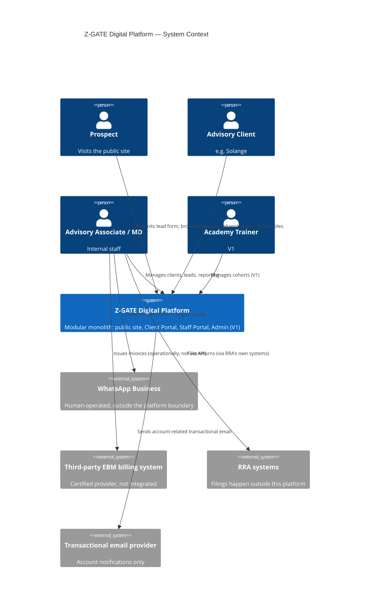

# Z-GATE Digital Platform — System Context

C4-model Level 1 (System Context): who and what interacts with the platform, and where the platform's boundary actually sits. No internal structure here — that's `MODULE_ARCHITECTURE.md`.

## Actors and external systems (sourced, not invented)

| Actor/system | Relationship to the platform | Source |
|---|---|---|
| **Prospect** | Visits the public website, submits a lead form | `docs/product/PERSONAS.md`, `docs/ux/USER_JOURNEY_MAP.md` Journey 1–3 |
| **Advisory client** (e.g. Solange) | Logs into the Client Portal | `docs/product/PERSONAS.md` |
| **Advisory Associate** | Uses the Staff Portal | `docs/business/ROLE_MATRIX.md` |
| **Managing Director** | Uses Internal Reporting, Admin (V1) | `docs/business/ROLE_MATRIX.md` |
| **Academy Trainer** (V1) | Uses the Academy staff module | `docs/business/ROLE_MATRIX.md` |
| **WhatsApp Business** | Stays a separate, human-operated channel — **not integrated into the platform at MVP/V1**; urgent issues and most client-initiated contact happen here, outside the system boundary | `docs/ux/EXPERIENCE_REQUIREMENTS.md` §5, `docs/ux/USER_JOURNEY_MAP.md` Journey 9 |
| **EBM billing system** (third-party, certified) | Z-GATE operates through an existing certified EBM provider for statutory invoicing — **no integration exists or is planned**; this is an explicit non-goal | `docs/product/PRD.md` §2, `docs/discovery/RISKS.md` |
| **RRA (Rwanda Revenue Authority)** | Receives filings Advisory prepares — **no API integration**; filings happen through RRA's own systems/EBM devices, outside this platform | `docs/business/BUSINESS_RULES.md` §5 |
| **NCSA / Data Protection Office** | Regulator; receives breach notifications per the Data Privacy Policy's committed timeline — **human/email process, not a system integration** at this scale | `docs/business/BUSINESS_RULES.md` §4 |
| **Email provider** (transactional) | Minimal use — account-related transactional email (e.g., password reset) | Architectural necessity, not a named business requirement |

## System context diagram

*(Renders in any Mermaid-compatible viewer — GitHub, GitLab, most markdown editors. If viewing as plain text, the relationships table above carries the same information.)*

## What sits outside the system boundary (deliberately)

- **WhatsApp** — remains the primary client-communication and urgent-issue channel. Building a WhatsApp Business API integration is not scoped at MVP or V1; this is a direct consequence of `docs/ux/EXPERIENCE_REQUIREMENTS.md` §5's finding that replacing WhatsApp with an in-product channel would be a regression, not an improvement, for the dominant persona.
- **EBM billing** — Z-GATE's own risk register already commits to "maintain relationships with 2+ certified EBM software providers" (`docs/discovery/RISKS.md`) rather than building one. The platform records *against* compliance obligations (a filing was made, a deadline was met) — it does not process payments or issue statutory invoices itself.
- **RRA/NCSA systems** — no API exists for either that this platform could realistically integrate with at this scale; both relationships stay human/document-mediated.

## What this document does not do

It does not specify internal module boundaries (`MODULE_ARCHITECTURE.md`), API contracts (`API_ARCHITECTURE.md`), or infrastructure topology (`DEPLOYMENT_ARCHITECTURE.md`) — this is purely the outermost boundary: what's in the system, what's outside it, and who/what touches the edge.
