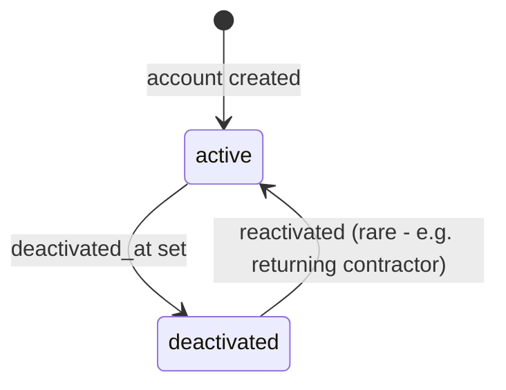
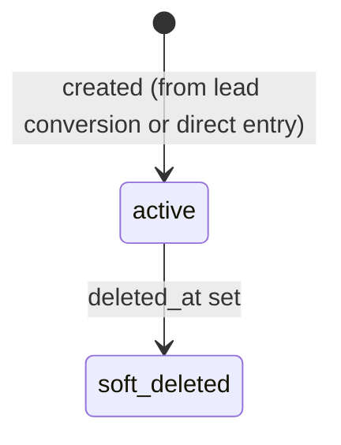
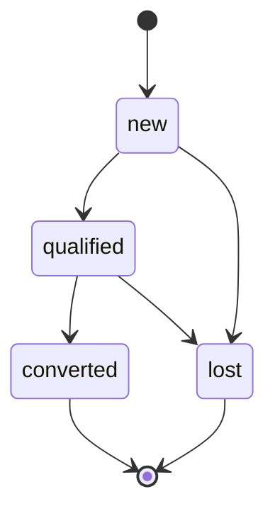
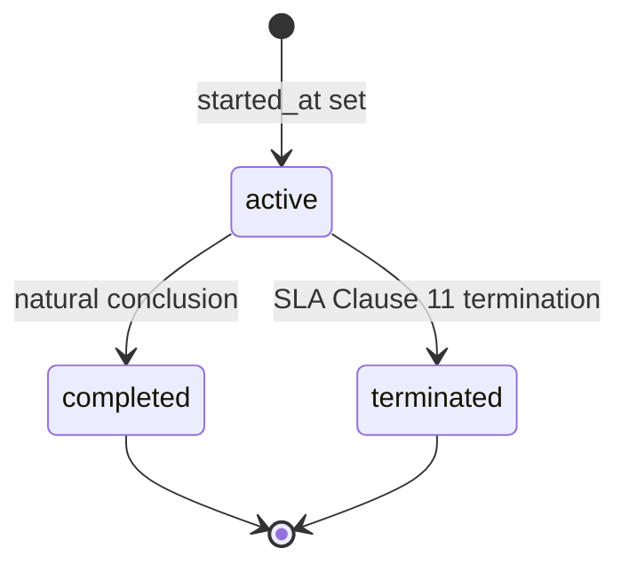
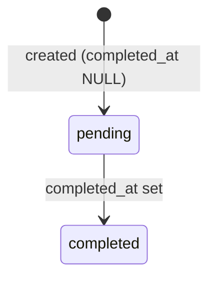

# Z-GATE Digital Platform — Data Lifecycles

Lifecycle states, retention rules, and the soft-deletion strategy for every MVP entity. Operationalizes `docs/security/DATA_PROTECTION_REQUIREMENTS.md`'s retention section at the table level — this document doesn't set new policy, it makes the existing policy concrete per entity.

## Lifecycle states

### `users`

- No hard delete of a `users` row ever, even on deactivation — a deactivated account is still the correct `completed_by`/`uploaded_by`/`user_id` attribution on historical compliance records. Deleting the row would corrupt the audit trail those references exist for.

### `clients`

- `active` is the only operational state — Client itself doesn't track "good standing" or similar business status; that's a function of its `engagements`' states, not the Client record.

### `leads`

- `converted` and `lost` are terminal — a converted lead doesn't revert (if the relationship ends later, that's the `engagement`'s lifecycle, not the lead's). No requirement exists anywhere in `docs/business/` or `docs/product/` for reopening a lost lead as the same record versus creating a new one if the prospect returns later — treated as a new lead, matching FEAT-02.2's simple manual-entry model.

### `engagements`

- `terminated` vs `completed` matters for retention: SLA Clause 11 governs what happens to a terminated engagement's data (return/delete per the Data Privacy Policy), while `completed` (e.g., a finite Tech project, when that module exists) may have different retention needs. Distinguishing them now costs nothing and avoids conflating "the relationship ended badly" with "the relationship ended successfully" in future reporting.

### `compliance_items`

- **"Overdue" is not a stored state** — it's `due_date < today AND completed_at IS NULL`, computed at query time. Storing it as a column would require a background job to keep it correct and would inevitably drift out of sync with reality — a derived value that's always correct beats a stored value that's occasionally wrong, especially for a compliance-critical status a client is trusting (`docs/design/PAGE_SPECIFICATIONS.md`'s Status Card explicitly treats "approaching deadline" as a computed framing, not a separate flag).

### `deliverables`

- No lifecycle beyond existence at MVP — a Deliverable is created once (uploaded) and read many times. No edit/versioning state exists because no product requirement calls for it (`docs/architecture/DOMAIN_ARCHITECTURE.md` §9: "not a general-purpose DMS").

### `access_log`

- **Append-only — no lifecycle transitions at all.** A row is written once and never updated or transitioned. This is a deliberate design property, not a missing feature: an audit log that can change state after the fact isn't trustworthy as an audit log.

## Retention rules

| Table | Retention rule | Status |
|---|---|---|
| `users` | Retained indefinitely (deactivated, not deleted) — needed for historical attribution | Settled |
| `clients` | Engagement duration + statutory period, then soft-deleted; hard-delete only after the statutory period is confirmed | **Blocked** on `docs/business/OPEN_BUSINESS_QUESTIONS.md` #9 — the exact statutory period for Advisory tax/financial records is still unconfirmed by legal counsel across every phase of this engagement. No hard-delete job exists until that number lands. |
| `leads` (non-converted) | No statutory retention requirement identified — a reasonable operational retention (e.g., reviewed/purged after a defined inactive period) is a business decision, not made here; not urgent given current lead volume | Open, low priority |
| `engagements`, `compliance_items`, `deliverables` | Same statutory-period dependency as `clients` — they're the actual compliance evidence the retention period protects | **Blocked**, same as `clients` |
| `access_log` | Retained at least as long as the data it logs access to, per the quarterly-review requirement (`docs/business/BUSINESS_RULES.md` §4) — never deleted opportunistically to "clean up" | Settled — retain, don't prune, until a specific retention decision says otherwise |

**Why nothing is hard-deleted yet:** building an automatic deletion job against a guessed statutory number risks destroying real compliance evidence — a materially worse failure than over-retaining data while legal counsel confirms the real number. This is the same judgment `docs/architecture/DATA_ARCHITECTURE.md` and `docs/security/DATA_PROTECTION_REQUIREMENTS.md` already made; this document doesn't relitigate it, it implements it.

## Soft-deletion strategy

- **Only `clients` carries a `deleted_at` column at MVP.** Child records (`engagements`, `compliance_items`, `deliverables`) are **not** independently soft-deleted — they become inaccessible through normal application queries once their parent Client is soft-deleted (every query path reaches them through `clients`, per `docs/architecture/MODULE_ARCHITECTURE.md`'s module-boundary rule), without needing a `deleted_at` column duplicated onto every child table.
- **`users` uses `deactivated_at`, not `deleted_at`** — different semantics: deactivation is expected and routine (an employee leaves, a contractor's cohort ends); it's not a data-removal action, so naming it "delete" would be misleading.
- **No table in this schema has a hard-`DELETE` code path at MVP** — the only way data leaves the database is the future, statutory-period-gated retention job. This is a deliberate, conservative default for a platform whose entire value proposition depends on being the reliable record of compliance-critical work.

## What this document does not do

It does not set the actual statutory retention number — that's a legal decision this document is structured to implement the moment it lands, not one it makes. It does not define V1/V2 entity lifecycles (Academy, Tech-ops) — those arrive with their own phases.
