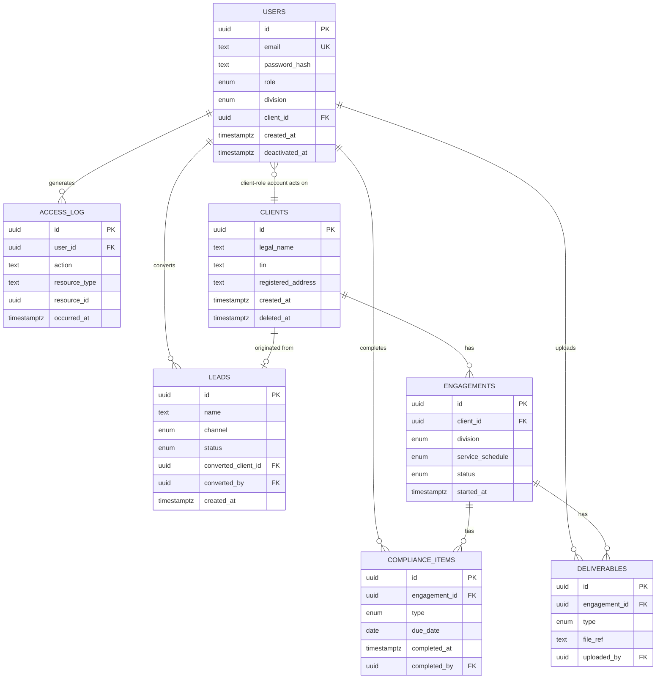

# Z-GATE Digital Platform — Entity Relationships

## MVP entity-relationship diagram

## Relationship rationale

| Relationship | Cardinality | Why |
|---|---|---|
| `clients` → `engagements` | 1 : many | One Client, engaged by potentially multiple divisions (`docs/business/CROSS_DIVISION_WORKFLOWS.md` §1's multi-Schedule model) — even though MVP only ever creates `division = 'advisory'` engagements, the relationship is built for the real multi-division future, not re-designed later (`docs/architecture/ADR/ADR-002-shared-client-record.md`) |
| `engagements` → `compliance_items` | 1 : many | One Advisory engagement accumulates many compliance items over its life |
| `engagements` → `deliverables` | 1 : many | Same reasoning |
| `leads` → `clients` (via `converted_client_id`) | 0..1 : 1 | A lead converts to *at most one* Client, once — modeled as a nullable FK directly on `leads` rather than a separate join table (`docs/architecture/DATA_ARCHITECTURE.md`'s original sketch had a separate `lead_conversions` table; this document simplifies that to a direct FK since the relationship is strictly 1:1 and a join table would add a table for no real benefit — a deliberate refinement, not a contradiction, of the architecture phase's high-level sketch) |
| `users` → `clients` (via `users.client_id`) | many : 1 (nullable) | Only populated for `role = 'client'` accounts; a staff/admin account never has a `client_id` — enforced by a `CHECK` constraint (see below), not just convention |
| `users` → `compliance_items` / `deliverables` (via `completed_by` / `uploaded_by`) | 1 : many | Attributes a compliance-critical action to a specific person — required for the audit trail this whole platform's trust model depends on |
| `users` → `access_log` | 1 : many | Every logged access ties to exactly one human user — no anonymous or system-generated log rows at MVP (`docs/architecture/DATA_ARCHITECTURE.md`: only human-initiated access to Confidential data is logged) |

## Constraints

### Foreign keys — deliberately `ON DELETE RESTRICT`, not `CASCADE`

Every FK above uses `ON DELETE RESTRICT` (or, in Postgres terms, the default `NO ACTION`), **not** `ON DELETE CASCADE`. This is a deliberate security/compliance decision, not an oversight: a `CASCADE` on `clients → engagements → compliance_items/deliverables` would mean deleting one row silently destroys a client's entire compliance history — the exact data `docs/architecture/DEPLOYMENT_ARCHITECTURE.md`'s backup section calls "compliance-evidence loss," not just a data-loss incident. Deletion of a Client, where it's ever genuinely needed, goes through the soft-delete path (`clients.deleted_at`) specified in `DATA_LIFECYCLES.md`, never a hard `DELETE` that could cascade.

### Check constraints

- `users`: `CHECK (role != 'client' OR client_id IS NOT NULL)` and `CHECK (role = 'client' OR client_id IS NULL)` — a client-role account always has exactly one linked Client, a staff/admin account never does. This is the database-level backstop for `docs/security/THREAT_MODEL.md`'s Critical-rated client-to-staff privilege-escalation concern — even if application logic had a bug, the schema itself refuses to represent an invalid state.
- `leads`: `CHECK (status != 'converted' OR converted_client_id IS NOT NULL)` — a lead marked converted must actually reference the Client it converted to.
- `compliance_items`: `CHECK (completed_by IS NULL OR completed_at IS NOT NULL)` — can't attribute a completion to someone without recording when it happened.

### Uniqueness

- `users.email` — unique, case-insensitively (a citext column or a unique index on `lower(email)`, implementation detail for the backend phase) — prevents both accidental duplicate accounts and a real security issue (two accounts differing only in email case, defeating uniqueness assumptions elsewhere).

## Indexes (beyond what PK/FK/UNIQUE already provide)

| Table | Index | Why |
|---|---|---|
| `compliance_items` | `(engagement_id, due_date) WHERE completed_at IS NULL` | Partial index — directly serves FEAT-06.1's "client list sorted by compliance due date," and only pending items matter for that sort; a completed item shouldn't slow down or clutter the query it was built for |
| `leads` | `(status)`, `(channel)` | Serves FEAT-03.1's filterable lead list |
| `engagements` | `(client_id)` | Already implied by the FK, called out because it's the platform's single most common join (nearly every Advisory query starts from "this client's engagements") |
| `access_log` | `(resource_type, resource_id)`, `(occurred_at)` | Serves the quarterly access-review process (`docs/security/RBAC_SECURITY_MODEL.md`) — "who accessed this record" and "what happened in this time window" are the two real query shapes that process needs |

## What this document does not do

It does not diagram V1/V2 entities (Academy, Tech-ops, Data-service, Notifications) — their relationships get the same rigor when their phase actually starts. It does not specify Postgres-version-specific syntax details (exact index type, citext extension availability) — those are confirmed at migration-implementation time in `MIGRATION_STRATEGY.md`.
