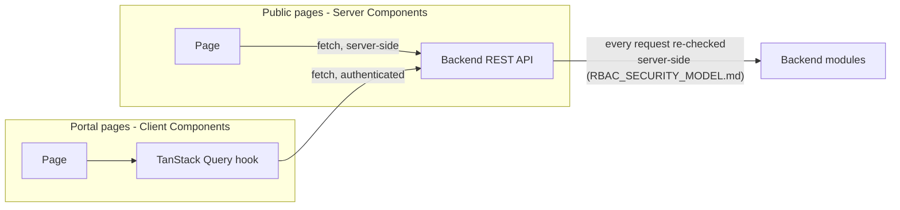

# Z-GATE Digital Platform — Frontend Architecture

**Source order:** `docs/ux/` → `docs/design/` → `docs/product/` → `docs/architecture/` → `docs/security/`. This is documentation only, per this phase's OUTPUT scope — no scaffolding is created here; real code lands in the implementation phases (`feat(website)`, etc.) that follow, per the commit roadmap already in use.

## Framework decision: Next.js (App Router), React, TypeScript

`docs/architecture/MODULE_ARCHITECTURE.md` set the requirement without naming a framework: "server-rendering/static-generation capable for the public website... client-rendering acceptable for authenticated portals." One framework needs to satisfy both, in one codebase, sharing one component library — not two different tools for two different surfaces.

| Option | Verdict |
|---|---|
| **Next.js (App Router)** | **Chosen.** Server Components + static generation cover the public website's SEO/performance needs (`docs/marketing/SEO_STRATEGY.md`); Client Components cover the interactive portal screens — one framework, one dependency set, one component library reused across both. React has the strongest alignment with the Junior Developer role's "modern web stack (JavaScript/TypeScript, a common backend framework)" signal (`docs/architecture/ADR/ADR-003-typescript.md`) and the deepest local hiring pool (kLab/Andela-trained developers skew heavily toward React, per the same market context `docs/business/BUSINESS_ALIGNMENT.md` already cites) — this is informed judgment, not a sourced fact from an approved document, and is flagged as such. |
| Remix | Rejected — a reasonable alternative with a strong forms story, but React/Next.js's larger local talent pool and ecosystem maturity outweigh it for a small, cost-conscious, junior-skewed team. |
| SvelteKit / Vue-Nuxt | Rejected — smaller local hiring pool, no signal from any approved document pointing this direction. |
| Two separate tools (a static-site generator for marketing + a plain SPA for the app) | Rejected — directly violates "avoid unnecessary dependencies" and "prefer reusable components": two build systems, two component libraries, duplicated design-token wiring. |

**Deployment relationship to the backend:** the frontend is a separate deployable consuming the backend's REST API over HTTP (`docs/architecture/API_ARCHITECTURE.md`'s "who consumes the API" already frames it this way) — this does not contradict the modular-monolith decision (`docs/architecture/ADR/ADR-001-modular-monolith.md`), which governs the *backend's* internal structure, not whether a frontend process exists separately from it.

## Application structure

```
apps/web/                     (created in the implementation phase, not this one)
├── app/
│   ├── (public)/              — public website route group: Home, division pages, Contact
│   ├── (portal)/               — Client Portal + Staff Portal route group (authenticated)
│   ├── (admin)/                — Admin Platform route group (V1, authenticated + admin role)
│   └── layout.tsx               — root layout: design tokens, fonts, global providers
├── components/
│   ├── ui/                      — design-system primitives, 1:1 with docs/design/COMPONENT_SPECIFICATION.md
│   └── features/                — composed, feature-specific components (no business logic - see COMPONENT_ARCHITECTURE.md)
├── lib/                         — data-fetching clients, shared computation (e.g. "is this compliance item overdue"), validation schemas
├── hooks/                       — TanStack Query hooks, form hooks
└── styles/                      — design tokens as CSS custom properties (see below)
```

One route group per surface, matching `docs/ux/INFORMATION_ARCHITECTURE.md`'s four surfaces exactly — full detail in `ROUTE_MAP.md`.

## Styling approach: CSS custom properties + CSS Modules, no new styling dependency

`docs/design/DESIGN_SYSTEM.md`'s tokens (color, type, spacing) are already expressed as CSS custom properties in the approved Brand Identity Guide (`:root { --ink: #0B0F1A; ... }`) — this architecture continues that exact pattern rather than introducing Tailwind, styled-components, or another CSS-in-JS library. **Why:** it's zero new dependencies, it's the pattern the brand's own approved HTML artifact already uses, and `docs/design/DESIGN_SYSTEM.md`'s token set is small and stable enough that a utility-class framework's main benefit (rapid ad hoc styling) isn't needed — every component's styling should trace to a defined token, not an arbitrary utility value. CSS Modules scope component-level styles without needing a runtime CSS-in-JS library.

## Data flow, at a glance



Full detail: `STATE_MANAGEMENT.md` (data fetching, form/validation strategy), `FRONTEND_SECURITY.md` (why authorization never lives in the frontend).

## What this document does not do

It does not scaffold the actual Next.js project — that happens in the implementation phase this documentation feeds. It does not pick exact npm package versions — `docs/devops/DEVELOPMENT_ENVIRONMENT.md`'s established pattern (install for real, verify, then commit) applies when that implementation phase begins.
