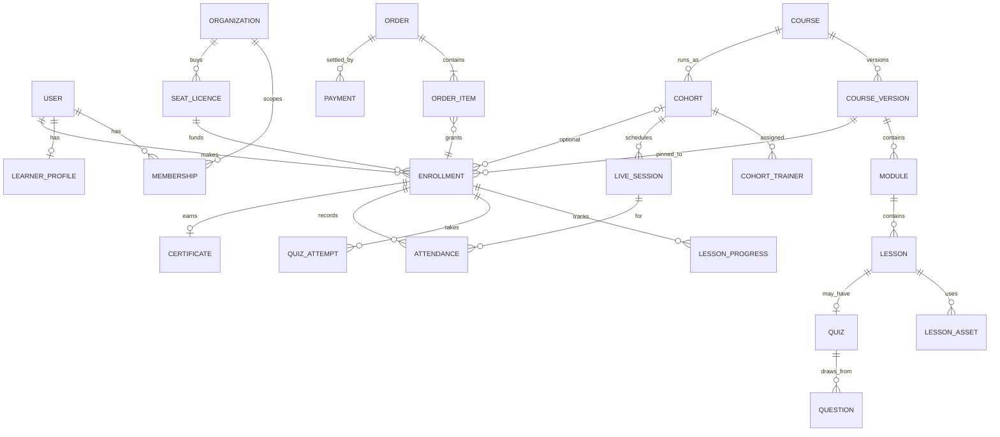
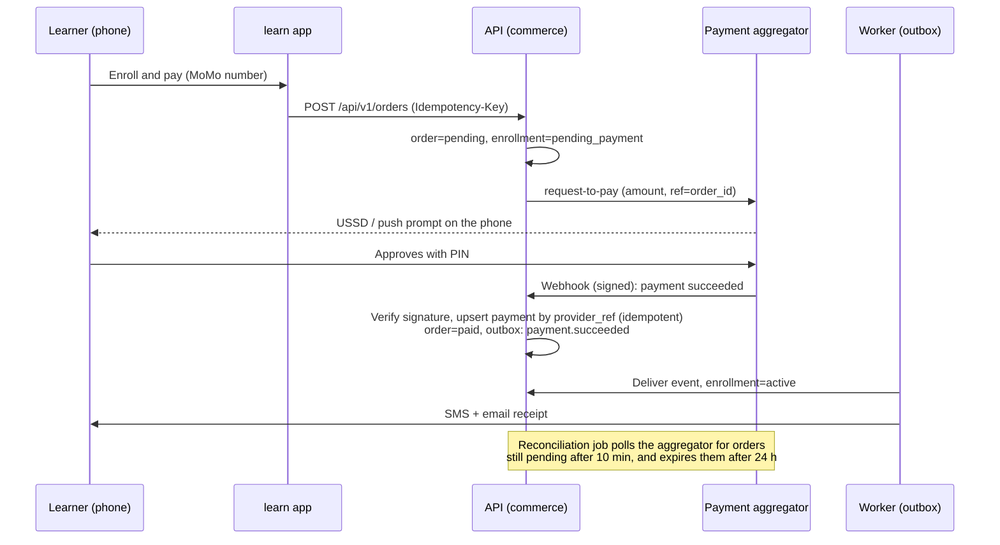

# 03 — E-Learning Platform (`learn.{domain}`)

## 1. Product definition

**Z-GATE Academy Online** is a mobile-first, low-bandwidth-tolerant learning platform for **blended** professional training. It supports live cohorts (in person or online) and self-paced courses. Its edge over generic course marketplaces:

1. **Curricula built from real Advisory casework** (tax, bookkeeping, EBM). This is already the Academy's documented differentiator (`docs/business/BUSINESS_REQUIREMENTS.md` §3).
2. **Built for Rwanda's connectivity profile**: 88.7% mobile connections against 34.2% internet penetration (`docs/ux/UX_RESEARCH.md`). It is text-first, uses adaptive low-bitrate video, and keeps working offline.
3. **Mobile-money payments** (MTN MoMo, Airtel Money).
4. **Publicly verifiable certificates.** This directly answers the documented learner objection "will this certificate mean anything to an employer?" (`docs/ux/UX_RESEARCH.md` §5).
5. **A bridge to Advisory.** SME-owner learners can opt in to become Advisory leads.

**Build or buy?** Recommendation: **build a focused LMS on the existing stack** (ADR-P1). Off-the-shelf options were considered:
- **Moodle** is self-hostable in Rwanda, which satisfies residency.
- **Hosted SaaS LMSs** (Thinkific, TalentLMS, LearnWorlds and similar) would be faster to launch.

Both fall short on the same points: weak mobile-money support, no integration with Z-GATE's CRM and Advisory, poor low-bandwidth behaviour, and (for SaaS) personal data held offshore, which conflicts with ADR-004. **The fallback is explicit:** if the team cannot staff the build (see [07 §3](07-MIGRATION-PLAN.md#3-phased-roadmap)), run Course 1 on a self-hosted Moodle as a stopgap. Keep the website hand-off contract in [02 §6](02-TARGET-ARCHITECTURE.md#6-how-the-website-hands-off-to-the-lms) unchanged, so the LMS can be swapped later.

## 2. Roles

| Role | Scope | Can |
|---|---|---|
| Visitor | — | Browse the public catalog, verify a certificate |
| **Learner** | Self | Sign up, enroll, pay, learn, take quizzes, submit assignments, download and share their own certificates, manage consents, export or delete their data |
| **Org admin** (corporate client) | `organization:{id}` | Buy seats, invite learners, see **aggregate** cohort progress only. Individual results are visible only with each learner's consent (SLA Schedule B; `docs/business/OPEN_BUSINESS_QUESTIONS.md` #14). |
| **Trainer** | `cohort:{id}` | Roster, attendance, grading, announcements, live-session links, for **assigned cohorts only** (the v1 `assertTrainerAccess` rule carries over) |
| **Content author** | `course:{id}` | Draft and edit course versions. Cannot publish. |
| **Academy admin** | Academy-wide | Publish courses, create cohorts, assign trainers, issue or revoke certificates, refunds, reporting |
| Platform admin | Global | User and role management, security settings. MFA mandatory. |

## 3. Scope by release

**MVP:** enough to run Courses 1 and 2 online and blended, with paying individual learners.

| # | Capability | Notes |
|---|---|---|
| 1 | Sign-up and login: email or phone + OTP; verification; password reset; sessions that can be revoked | [02 §5](02-TARGET-ARCHITECTURE.md#5-identity-sessions-and-access-control) |
| 2 | Public catalog: course pages, outcomes, syllabus, price, upcoming cohorts | Also feeds the website through `/api/v1/public/catalog` |
| 3 | Enrollment in a cohort or self-paced course | Idempotent; stores attribution (UTM) |
| 4 | Checkout with MTN MoMo / Airtel Money; free courses; manual "mark as paid" by an admin for cash or bank transfer | §6 |
| 5 | Course structure: course → version → modules → lessons | Versioning means editing a live course never changes it under enrolled learners |
| 6 | Lesson types: rich text, video (HLS), downloadable files (PDF or XLSX templates), external live-session link | |
| 7 | Progress: per-lesson completion, resume where you left off, course percentage | |
| 8 | Quizzes: question bank, single/multiple choice and numeric questions, server-side grading, pass mark, **attempt limits and retakes** | The retake policy is an open business question (#12) and needs a decision before launch |
| 9 | Live-cohort tools: attendance, roster, trainer grading of practical assessments | Ported from the v1 Academy module |
| 10 | Certificates: PDF with QR code, issued automatically when completion rules are met, **public verification page**, revocation | §7 |
| 11 | Notifications: email and SMS for enrollment confirmation, payment receipt, session reminders, certificate issued | Through the queue |
| 12 | Learner dashboard: my courses, next lesson, upcoming sessions, certificates | |
| 13 | Trainer console, mobile-first and usable in the room during a session | `docs/ux/UX_RESEARCH.md` §6 |
| 14 | Admin: course and version authoring, cohort management, enrollment and payment views, refunds | |
| 15 | Privacy: consent capture, privacy notice, data export, account deletion request | Fixes N-5 |
| 16 | Basic reporting: enrollments, revenue, completion and pass rates per course and cohort | |

**V1:** corporate and engagement features.
- Organizations and seat licences (B2B), org admin dashboard (aggregate data only)
- Assignments with file submission and rubric grading
- Kinyarwanda UI, then French; translated course content when it exists
- PWA offline mode (§5); WhatsApp notifications
- Discussion per lesson, moderated by trainers
- Discount codes and bundles (e.g. Advisory retainer clients)
- Learning analytics: drop-off by lesson, at-risk learners flagged to trainers

**V2:** scale and ecosystem.
- Self-paced subscriptions or bundles
- Built-in live-classroom integration (self-hosted Jitsi) with attendance capture
- xAPI statement export; SCORM package import, only if a partner requires it
- Open Badges 3.0 / verifiable-credential export for certificates
- Public instructor profiles; multi-trainer courses
- AI features (§9), once their gates are cleared

## 4. Domain model

Key schema decisions, and how each differs from v1:

| Decision | v1 | v2 |
|---|---|---|
| Learner identity | A `learners` row separate from `users`, usually with no account | **The learner is a `user`** with a `learner_profile`. Staff-recorded walk-in learners are created as *unclaimed* users who can claim the account later by verifying their phone or email. |
| Price | `fee text` | `price_amount bigint` in ISO-4217 minor units plus `currency char(3)`. Note that RWF has an exponent of 0, so 40 000 RWF is stored as `40000`. |
| Duration and sessions | Free text | `estimated_minutes int`; live sessions stored as rows with `starts_at` / `ends_at` |
| Course edits | Seeded by a migration | **Draft → published versions.** Each enrollment is pinned to the `course_version_id` it bought. |
| Assessment | One pass/fail row per enrollment | Quizzes with attempts (`quiz_attempts`, `attempt_answers`), plus an optional trainer-graded practical. The completion rule is defined per course version. |
| Certificate | An HTML file | A `certificates` row with `verification_code` (≥ 50 bits, Crockford base32, e.g. `ZG-7Q4M-K2XD-91`), `pdf_object_key`, `issued_at` and `revoked_at` / `revocation_reason` |
| Attendance | `session_number int` with no upper bound (KI-12) | A foreign key to `live_sessions`, which removes the defect by design |
| Score | `numeric(5,2)` rendered raw (KI-11) | Stored as `numeric`, formatted only in the UI layer |
| Timestamps / IDs | uuid v4 | **uuid v7** (time-ordered, better index locality); all timestamps `timestamptz` |
| Soft delete | Partial | `deleted_at` on user-facing aggregates. Hard deletion only through the retention job (once retention periods are confirmed, OBQ #9). |

## 5. Mobile and low-bandwidth design (non-negotiable requirements)

| Requirement | Implementation |
|---|---|
| Initial JS of at most **150 KB gzipped** on learner pages | Server components by default; forms bundle loaded only where used (KI-17); budget enforced in CI |
| Video starts in under 3 s on a 3G-class connection | HLS starting at the **240p** rendition, ABR up to 720p, poster image, `preload="none"` until the learner presses play |
| **Data-saver mode** | Respects `Save-Data` and `navigator.connection.saveData`, plus a manual toggle. Video is capped at 360p, images get lower `srcset` candidates, and audio-only playback is available. |
| **Text-first lessons** | Every video lesson has a transcript and a key-points summary. This helps accessibility and bandwidth, and it makes lessons searchable. |
| **Offline (V1, PWA)** | The service worker caches the app shell, visited text lessons and PDFs. Progress events are queued in IndexedDB with client-generated event IDs and synced idempotently. |
| Resilient forms | Autosave drafts; retry with backoff; specific "connection lost" messages (the v1 ContactForm pattern carries over) |
| Small screens first | 360 px is the baseline design width; touch targets of at least 44 px; no hover-only affordances |
| SMS as a first-class channel | OTP login, payment receipts and session reminders all work for users who never open email |

## 6. Payment flow (mobile money)

Rules:
- **Never trust the browser** for payment status. Only a verified webhook or a reconciliation poll can mark an order paid.
- **Idempotency everywhere:** an `Idempotency-Key` on order creation, and a unique `(provider, provider_ref)` on payments.
- Amounts are always recomputed on the server from the course version price and any discount. The client-sent amount is ignored.
- Refunds are admin-only, require a reason, and are audited. ADR-006 still holds: the platform **records** payments, and EBM invoicing continues through the certified provider. A "payment received, EBM invoice pending" admin queue closes the loop.

## 7. Certificates and verification

- Issued automatically when the course version's completion rule is satisfied (for example: all required lessons done, quiz ≥ 70%, attendance ≥ 90% for cohort mode). This beats the SLA target of "within 5 business days" (SLA Schedule B).
- The PDF is generated by the worker and stored privately. The learner downloads it through a signed URL.
- **Public verification page:** `learn.{domain}/verify/{code}` shows the learner's name as printed, the course, the issue date and the status (valid or revoked). Nothing else. It is `noindex` and rate-limited.
- Share actions: copy link, LinkedIn "Add to profile" pre-filled URL, and WhatsApp share. **Every share is free marketing**, which makes this a growth loop rather than an afterthought.
- Revocation is admin-only, needs a reason, is audited, and shows as *Revoked* on the verify page.

## 8. Assessment integrity

- Correct answers never reach the client before submission, and grading happens only on the server.
- Questions and options are drawn and shuffled per attempt from the bank. Optional time limit, enforced on the server.
- Attempt limits and cool-downs per quiz. Retake rules come from the course version, once OBQ #12 is decided.
- Practical assessments are trainer-graded with a rubric. The trainer's identity and timestamp are audited (v1 pattern).
- Proportionate expectations: this is professional upskilling, not high-stakes exams. No proctoring.

## 9. AI integration readiness (gated)

AI is **not** in MVP scope. No approved business document scopes it yet (`docs/product/PRODUCT_VISION.md` anti-scope; OBQ #16). The architecture is still prepared for it, so that adding AI later is a feature and not a re-platform:

- An `ai` port in the `platform` context, provider-agnostic, with versioned prompts and evaluation sets stored in the repository.
- **Data rules:** course content (Public/Internal) may be sent to a model provider. Learner-generated text is redacted or used only with notice. No learner data is ever used to train vendor models. **A DPIA is run before any learner-facing AI feature** (Data Privacy Policy §12).

Candidates in order of value against risk:

| # | Feature | Value | Risk | Gate |
|---|---|---|---|---|
| 1 | Automatic captions and transcripts for course video | Accessibility, low bandwidth, search | Low (content only; human review) | Kinyarwanda speech-to-text quality must be validated |
| 2 | Trainer assistant: draft quiz questions from lesson text | Faster authoring | Low (human approves before publishing) | — |
| 3 | Draft translation en → rw/fr | Localization speed | Low to medium (human review required) | Native-speaker reviewer |
| 4 | Course tutor: answers grounded only in the enrolled course's published lessons, with citations, refuses out-of-scope questions | Learner support at scale | Medium (accuracy, PII in questions) | DPIA, evaluation set, opt-in, clear AI labelling |
| 5 | At-risk learner signals for trainers | Completion rate | Medium (profiling) | DPIA; shown to trainers only; explainable rules first, ML later |

## 10. Non-functional requirements

| Criterion | Target |
|---|---|
| **Security** | OWASP ASVS 4.0 **Level 2**. MFA for all staff roles. Details in [05](05-SECURITY-COMPLIANCE.md). |
| **Performance** | API p95 under 300 ms and p99 under 800 ms for learner reads. LCP under 2.5 s, INP under 200 ms and CLS under 0.1 at p75 on mid-range Android over 4G. |
| **Reliability** | SLO **99.5%** monthly availability for learn (about 3.6 h of error budget a month). RPO 15 min, RTO 4 h. |
| **Scalability** | Launch: about 1,000 registered learners, 200 concurrent, a 50-learner spike at cohort start. Must scale to 10× by adding API instances, with no redesign (stateless API, object storage, queue). |
| **Accessibility** | **WCAG 2.2 AA** (raised from 2.1). Captions on every video. Transcripts. Full keyboard support. Automated axe checks in CI. Plain language as the brand voice requires. |
| **Usability** | A new learner can go from course page to first lesson in **under 5 minutes** on a phone. A trainer can take attendance for 20 learners in **under 60 seconds**. |
| **Portability** | Runs anywhere that offers Linux VMs, Postgres and an S3 API. No proprietary serverless. One image promoted across environments. |
| **Integration** | OpenAPI 3.1, `/api/v1`, signed outbound webhooks (`course.published`, `enrollment.activated`, `certificate.issued`), and the outbox for internal events |
| **Localization** | i18n framework from day one (`en`, `rw`, `fr`); locale-aware dates and currency |

## 11. Business model and KPIs

**Revenue streams.** Prices are business decisions. Only the existing RWF 40,000 cohort fee is sourced (`backend/db/migrations/010_academy_courses.sql`).
- Live / blended cohort fee (existing model)
- Self-paced access to recorded versions of the same courses (a new, lower-touch product)
- Corporate seat bundles for SME client staff (B2B, through org admins)
- Training bundled into Advisory retainers (cross-division)
- A free short intro lesson or mini-course as a lead magnet

**KPIs**, instrumented from day one through the analytics funnel in [02 §6](02-TARGET-ARCHITECTURE.md#6-how-the-website-hands-off-to-the-lms):

| KPI | Definition |
|---|---|
| Course-page → paid conversion | Paid enrollments ÷ unique course-page visitors, by channel (UTM) |
| Payment success rate | Succeeded ÷ initiated mobile-money payments |
| Activation | % of paid learners who complete their first lesson within 48 h |
| Completion rate | % of enrollments meeting the completion rule (cohort SLA: 90% session completion) |
| Time to certificate | Median time from completion to issue (target: under 1 h, automated) |
| Certificate verifications | Verification-page lookups. A proxy for employer recognition. |
| Learner → Advisory leads | Consented business-interest leads ÷ learners |
| Cohort fill rate | Enrolled ÷ capacity (target cohort size 15–20, SLA Schedule B) |
