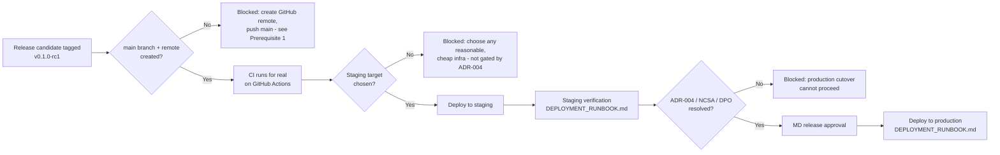

# Z-GATE Digital Platform — Deployment Plan (v0.1.0-rc1)

This release's specific rollout plan. `docs/devops/DEPLOYMENT_RUNBOOK.md` is the general, reusable step-by-step procedure this plan follows — this document is the concrete sequencing, ownership, and gates for *this* release candidate specifically, not a restatement of that runbook's mechanics.

## Sequence

## Prerequisites — what has to be true before each stage

### Before CI runs for real

1. **A GitHub remote must exist and `main` must be created.** Neither exists today (`docs/release/RELEASE_CHECKLIST.md`'s Branch section) — every CI/lint/test/build result in this entire engagement has been local verification, never an actual GitHub Actions run. This is the actual first blocking step of taking this release anywhere beyond this local repository, and it's a decision (which GitHub org/account, repo visibility, who has push access) this document doesn't make unilaterally.
2. Once a remote exists: push `develop`, create `main` from the tagged commit (`v0.1.0-rc1`), push `main`. This is what makes `.github/workflows/ci.yml`'s `ci`, `web-ci`, and `publish-images` jobs run for the first time ever, against a real, clean environment (which will also, finally, close the "migrations never verified against a live Postgres" gap in `docs/release/RELEASE_CHECKLIST.md`).

### Before staging deployment

- **Not blocked by ADR-004** — staging never holds real Client data (`docs/architecture/DEPLOYMENT_ARCHITECTURE.md`'s environment rules), so any reasonable, cheap infrastructure target can be provisioned as soon as it's chosen. No such target is chosen or provisioned as of this release candidate.
- Once chosen: follow `docs/devops/DEPLOYMENT_RUNBOOK.md`'s staging section exactly — pull the SHA-tagged image, run `scripts/migrate.mjs` against the staging database, replace the running container(s), verify `/api/health`/`/api/ready`, smoke test.

### Before production deployment

All of the following must be true — restated from `docs/release/KNOWN_ISSUES.md`'s business/compliance preconditions, not re-decided here:

- **ADR-004 resolved** (hosting region / data residency) — `docs/architecture/ADR/ADR-004-data-residency-hosting-region.md`.
- **NCSA registration complete**, if ADR-004 resolves to an option requiring it.
- **DPO designated** (or the MD-by-default arrangement explicitly reaffirmed as acceptable for launch) — `docs/security/INCIDENT_RESPONSE_REQUIREMENTS.md`.
- **Staging verification passed** for this exact commit/tag — never a different commit "close enough."
- **Explicit MD release approval**, recorded (`docs/devops/DEPLOYMENT_RUNBOOK.md`'s production section, step 3) — this document does not grant that approval; it defines what happens once it's given.
- **Monitoring and backups provisioned** to at least the minimum `docs/devops/MONITORING.md` and `docs/devops/BACKUP_RECOVERY.md` specify — deploying real Client data with no backup mechanism running would be the exact compliance failure those documents exist to prevent.

## What this release actually deploys, once unblocked

Two independently-versioned artifacts, built and published together from the same commit (`.github/workflows/ci.yml`'s `publish-images` job):

| Artifact | Image | Serves |
|---|---|---|
| Backend API | `ghcr.io/<repo>-api:<sha>` | `/api/*` routes, port 3000 (configurable via `PORT`) |
| Public website + portal + staff platform | `ghcr.io/<repo>-web:<sha>` | Everything under the frontend's routes, port 3001 |

Both images already declare `HEALTHCHECK` instructions and are built from this exact release candidate's reviewed source — no rebuild-from-source step exists between "CI publishes" and "runbook deploys," by design (`docs/devops/PRODUCTION_ARCHITECTURE.md`'s CI/CD section).

## Deployment strategy for this release

Single-instance replace, not blue/green or canary — matches `docs/architecture/DEPLOYMENT_ARCHITECTURE.md`'s explicit "no container orchestration platform" posture at this team size and traffic level. A brief availability window during the swap is expected, not a defect. This release, being release candidate 1, has no prior production version running yet, so there is nothing to "replace" — the first production deployment is a cold start, not a swap; `docs/devops/DEPLOYMENT_RUNBOOK.md`'s steps still apply (migrate, then start, then verify), just without a "previous container" to stop first.

## Post-deployment verification (staging and production alike)

1. `GET /api/health` → 200.
2. `GET /api/ready` → 200 with `"database":"ok"`.
3. Load the frontend; confirm it reaches the correct backend (`NEXT_PUBLIC_API_URL` matches the environment being verified, not another one).
4. Smoke test: a real login, a real lead-capture form submission, a real Academy enrollment view — the three golden paths spanning public/authenticated/Academy surfaces.
5. Monitor error rate and `/api/ready` for 15–30 minutes before considering the deployment complete (`docs/devops/DEPLOYMENT_RUNBOOK.md` step 8).

## Owners

| Decision/action | Owner |
|---|---|
| Create GitHub remote, push `main` | Whoever holds repository administration — not assigned in any approved document reviewed this engagement; flagged for the MD to designate |
| Choose staging infrastructure target | MD (cost/vendor decision, `docs/architecture/DEPLOYMENT_ARCHITECTURE.md`'s cost baseline) |
| Resolve ADR-004 | MD + Rwandan legal counsel (`docs/architecture/ADR/ADR-004-data-residency-hosting-region.md`'s own recommendation) |
| Production release approval | MD |
| Execute the deployment runbook | The contract/intern developer, or whoever holds deploy access once a target exists |

## What this document does not do

It does not create a GitHub remote, provision staging infrastructure, or deploy anything — every one of those requires a decision or a credential this document doesn't have. It does not resolve ADR-004 or any of the business/compliance preconditions it restates. It does not deploy to production — consistent with this phase's own explicit instruction not to.
