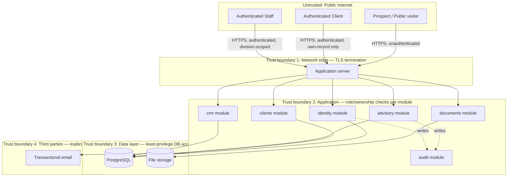

# Z-GATE Digital Platform — Security Architecture

**Source order:** `docs/business/` (especially the Data Privacy & Security Policy's already-committed rules) → `docs/architecture/` (modular monolith, module boundaries, ADRs) → `docs/discovery/SECURITY_BASELINE.md` (NCSA/DPO status). This document does not invent a security posture from scratch — it operationalizes commitments Z-GATE has already made in writing, using recognized frameworks to structure that work, and is honest about what's still pending.

## Framework alignment

- **NIST Secure Software Development Framework (SSDF)** — organizes this platform's security practices across the SSDF's four practice groups: *Prepare the Organization* (PO), *Protect Software* (PS), *Produce Well-Secured Software* (PW), *Respond to Vulnerabilities* (RV). Applied at a scale appropriate to a single-developer/contract-hire team (`docs/business/ROLE_MATRIX.md`) — not the enterprise-scale tooling SSDF is often applied with.
- **OWASP ASVS (Application Security Verification Standard)** — used to structure `SECURITY_REQUIREMENTS.md`. **Leveling decision:** ASVS **Level 1** (baseline, opportunistic-attacker-resistant) is the minimum bar for every module; ASVS **Level 2** (thorough, targeted at applications holding sensitive data) is the bar for the `advisory`, `clients`, `identity`, and `documents` modules specifically, since they handle Confidential-classified financial/personal data (`docs/architecture/DATA_ARCHITECTURE.md`'s classification table). This is a proportionate scoping decision — not a claim of ASVS certification, which requires formal verification against a real implementation that doesn't exist yet.
- **OWASP Top 10 / application security practices** — used throughout the threat model and requirements as the working vocabulary for common vulnerability classes (injection, broken access control, etc.).

## Security principles, applied concretely

| Principle | How it's actually implemented here, not just stated |
|---|---|
| **Least privilege** | Every module enforces authorization at its own boundary against the caller's role (`docs/architecture/MODULE_ARCHITECTURE.md`); a Client-role caller can only ever act on their own Client record; a Staff-role caller is scoped to their division (`docs/business/ROLE_MATRIX.md` §4). Formalized in `RBAC_SECURITY_MODEL.md`. |
| **Defense in depth** | No single control is trusted alone: network/transport (TLS), application (authz checks per module), data (encryption, access logging), and process (quarterly access review, incident response) each provide independent coverage — a failure in one layer doesn't collapse the whole system. |
| **Secure by design** | Security decisions are made in this architecture phase, before implementation — auth is self-hosted but built on standard, well-reviewed patterns (ADR-005), the audit log is append-only by construction (`docs/architecture/DATA_ARCHITECTURE.md`), and Confidential data never appears in dev/staging (already-committed rule, Data Privacy Policy Annex C). |

## Trust boundaries

Four trust boundaries, each with its own control: the network edge (TLS, rate limiting on unauthenticated endpoints per `docs/architecture/API_ARCHITECTURE.md`), the application layer (per-module role/ownership checks), the data layer (least-privilege database credentials per module, not one shared superuser connection), and third parties (deliberately minimal — see `docs/architecture/INTEGRATION_ARCHITECTURE.md`).

## Known, accepted current gaps (tracked, not hidden)

| Gap | Status | Risk classification | Tracked in |
|---|---|---|---|
| NCSA registration incomplete | Pending | **High** (process risk — see `THREAT_MODEL.md`) | `docs/discovery/SECURITY_BASELINE.md`, carried through every phase |
| DPO not yet designated | Pending | **High** | Same |
| Hosting region / data residency undecided | Open (ADR-004) | **High** | `docs/architecture/ADR/ADR-004-data-residency-hosting-region.md` |
| No secret-scanning/pre-commit tooling configured yet | Not yet built (no code exists) | **Medium** | `docs/discovery/SECURITY_BASELINE.md` |

This architecture is designed so that closing these gaps (once the business/legal decisions land) doesn't require re-architecting — e.g., the module boundaries and audit logging are built assuming they'll need to support a real NCSA-registered, DPO-overseen operation, even though that isn't true yet.

## What this document does not do

It does not certify compliance with NIST SSDF or OWASP ASVS — no implementation exists to verify against yet. It does not replace the Data Privacy & Security Policy's own legal commitments — this document operationalizes them architecturally, it doesn't supersede them.
